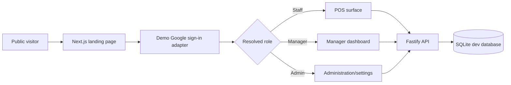
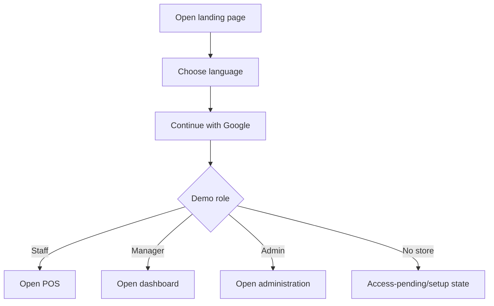
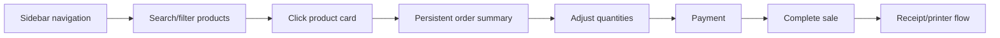
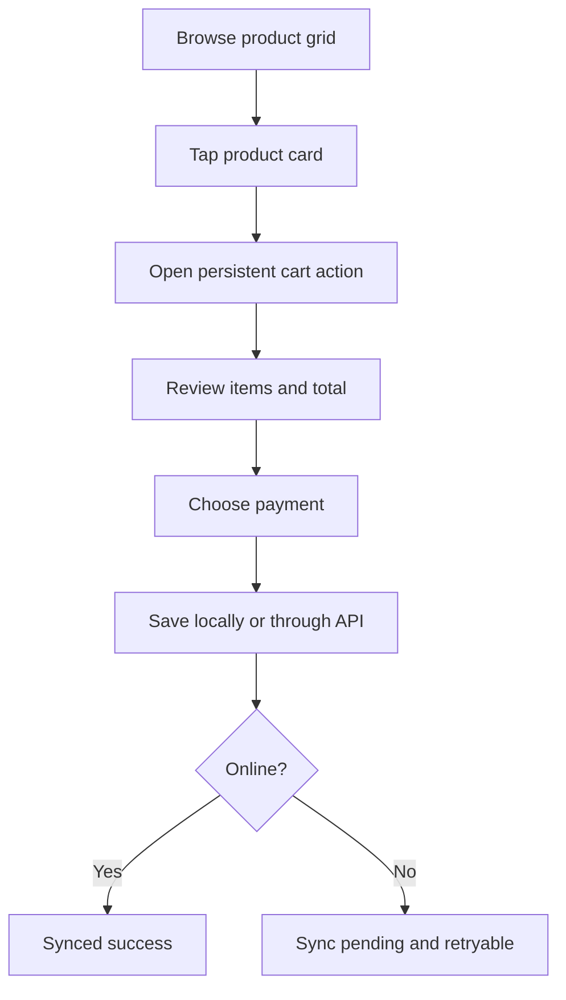

# SariStore


SariStore is a mobile-first and desktop-friendly web POS for a sole-proprietorship sari-sari store. It helps staff sell quickly, managers understand store operations, and admins manage users and permissions.

This project is standalone under `personal.dev/SariStore` and is not part of `northman-web-v2`.

## Product surfaces

SariStore has two intentional experiences over one shared domain model:

- **Mobile POS:** one-handed product browsing, persistent cart action, full-screen cart/payment, and clear offline state.
- **Desktop counter POS:** left navigation, product catalog in the center, and persistent order summary on the right.
- **Operations:** products, inventory, expenses, customers/utang, reports, settings, and user permissions.

## Current prototype

Implemented:

- Public landing page with English/Bisaya toggle, defaulting to Bisaya.
- Demo Google sign-in dialog with staff, manager, and admin roles.
- Staff routing to `/pos`.
- Responsive POS catalog with category filters and product search.
- Clickable product cards with icons, descriptions, prices, and add-to-order actions.
- Desktop sidebar and order summary.
- Mobile full-screen cart behavior.
- Demo sale completion and success notice.
- Fastify health and demo-auth endpoints.
- SQLite demo user persistence.
- PM2 development processes bound to the local Tailscale IP.

Planned:

- Real Google OAuth and secure sessions.
- Manager dashboard and admin settings.
- Product and inventory persistence.
- Payments, utang, expenses, receipts, printer dialog, and reports.
- Offline transaction queue and synchronization.

## Technology

| Layer | Choice |
|---|---|
| Web | Next.js + React + TypeScript |
| API | Fastify + TypeScript |
| Demo persistence | SQLite via `better-sqlite3` |
| Local-first client persistence | IndexedDB (planned) |
| Development process manager | PM2 |
| Development network | Tailscale IP |
| Icons | Lucide React |
| Styling | Component-owned CSS, CSS Modules, Tailwind, or reusable primitives as appropriate |

## Architecture



## Authentication and authorization

The current sign-in is explicitly demo-only. It uses the same identity shape planned for real Google OAuth:

```text
user id → display name → store membership → role → effective permissions
```

Roles:

- **Staff:** checkout and permitted payment activity.
- **Manager:** store products, pricing, inventory, expenses, utang, reports, reconciliation, and staff management.
- **Admin:** platform configuration, accounts, role assignment, per-user permissions, support, and system health.

Authorization will use role defaults plus explicit per-user grants/revocations. API authorization remains authoritative; frontend visibility is only a usability layer.

## Main flows

### Landing and sign-in



### Desktop POS



### Mobile POS



## Development setup

Requirements:

- Node.js compatible with the installed Next.js version
- pnpm 10+
- PM2
- Tailscale, when remote device access is needed

Install dependencies from this standalone directory:

```bash
cd /home/northman-gaming-dashboard/personal.dev/SariStore
pnpm install --ignore-workspace
```

Configure `.env` from `.env.example`:

```env
SARISTORE_TAILSCALE_IP=100.117.95.128
SARISTORE_API_PORT=4300
SARISTORE_WEB_PORT=4301
SARISTORE_DATABASE_PATH=./data/saristore.sqlite
```

Start development with PM2:

```bash
set -a
. ./.env
set +a
pm2 start ecosystem.config.cjs --update-env
pm2 save
```

URLs:

- Landing: `http://<tailscale-ip>:4301/`
- POS: `http://<tailscale-ip>:4301/pos`
- API health: `http://<tailscale-ip>:4300/health`
- Demo auth: `http://<tailscale-ip>:4300/auth/demo/manager`

Useful commands:

```bash
pm2 status
pm2 logs saristore-web-dev --lines 50
pm2 logs saristore-api-dev --lines 50
pm2 restart saristore-web-dev --update-env
pm2 restart saristore-api-dev --update-env
```

## Verification

Run the TypeScript check:

```bash
./node_modules/.bin/tsc --noEmit
```

Every UI change should review:

- 320px, 375px, 768px, 1024px, and 1440px widths.
- Empty, loading, error, retry, disabled, and large-data states.
- Keyboard navigation and visible focus.
- Reduced-motion behavior.
- Light and dark themes where implemented.
- Offline/slow-network behavior for transaction flows.
- Duplicate taps and duplicate sale protection.

## Design and code standards

- Keep product names more prominent than categories and descriptions.
- Use clear visual hierarchy, readable contrast, and 44px minimum touch targets.
- Use Lucide or another consistent icon system; do not use emoji as product icons.
- Keep code human-readable with descriptive names, focused functions, typed contracts, and minimal duplication.
- Keep translations in typed locale dictionaries. Every visible label must exist in English and Bisaya.
- Styling may use component-owned CSS, CSS Modules, Tailwind, or reusable primitives. Avoid scattered inline styles and JavaScript-driven animation timers.
- Use purposeful motion for state feedback and transitions, with `prefers-reduced-motion` support.
- Do not add production OAuth credentials, secrets, or deployment configuration to the repository.

## Documentation

- [PRD.md](./PRD.md) — product scope and acceptance criteria
- [ARCHITECTURE.md](./ARCHITECTURE.md) — system and experience architecture
- [ARCHITECTURE_ESSENTIALS.md](./ARCHITECTURE_ESSENTIALS.md) — non-negotiable implementation constraints
- [AGENTS.md](./AGENTS.md) — project-specific agent instructions

